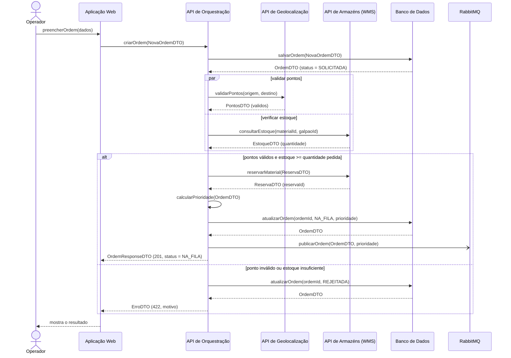
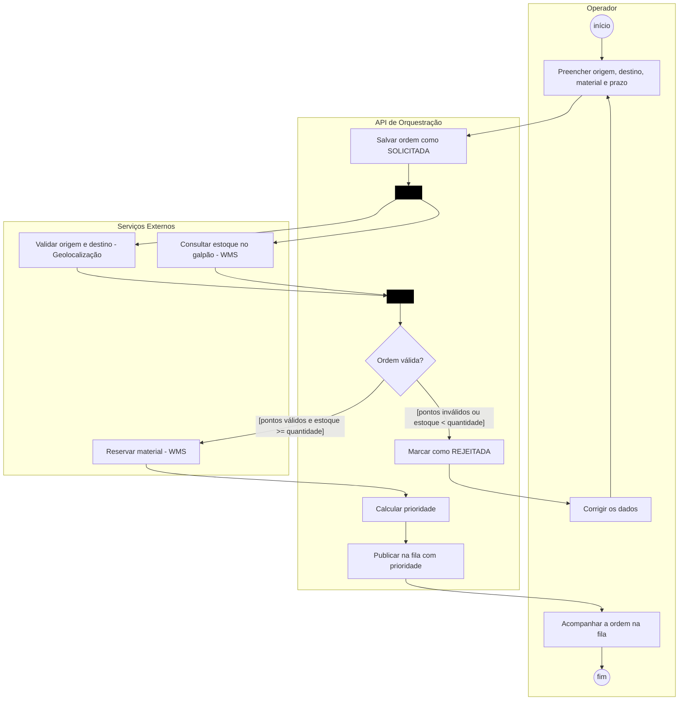
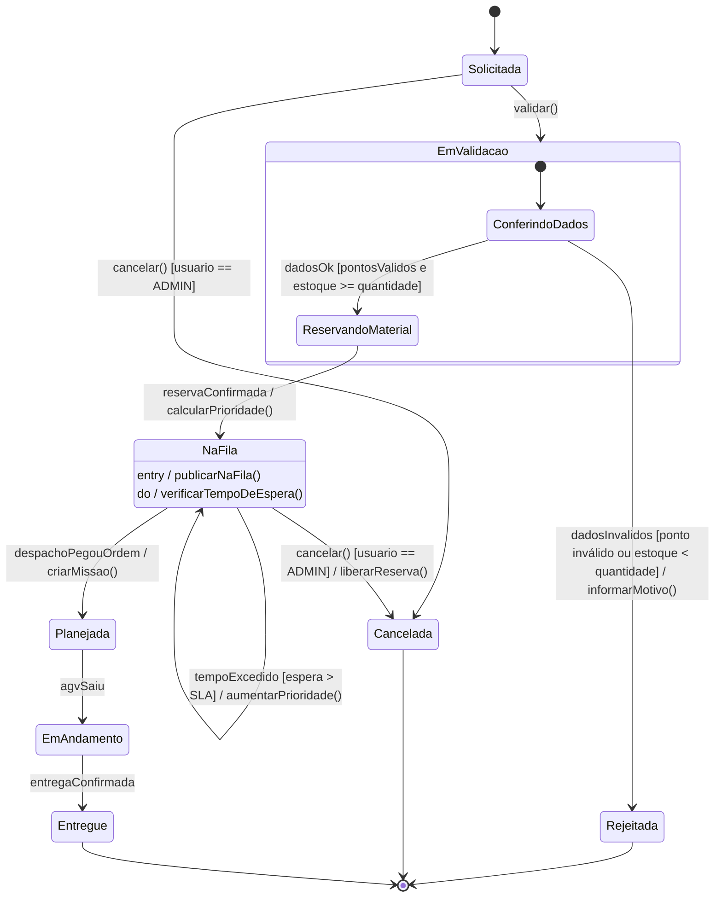
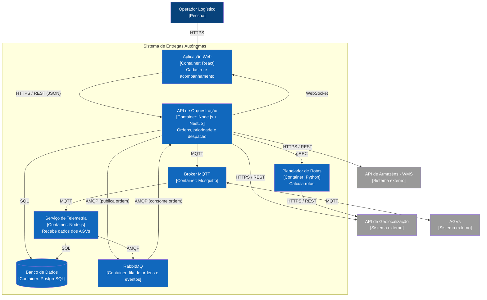

# APS 3 - Cadastro e Priorização de Ordens de Entrega

- **Aluno:** Dheyvid de Bastos Pinto
- **Disciplina:** Modelagem de Software (Prof. Sidney L. da Silva)
- **Projeto do grupo:** Sistema de Logística de Entregas Autônomas

## O que é a funcionalidade

Escolhi o **cadastro de ordens de entrega**, que é por onde toda entrega começa no sistema.

O operador informa de onde sai o material, para onde vai, qual material, a quantidade e o prazo. Antes de aceitar a ordem, o sistema confere duas coisas ao mesmo tempo:
- se a origem e o destino existem (API de Geolocalização);
- se tem material suficiente no galpão (API de Armazéns / WMS).

Se estiver tudo certo, o material é reservado, o sistema calcula a prioridade da ordem e coloca ela numa fila do RabbitMQ. Se não, a ordem é rejeitada e o operador vê o motivo.

A prioridade leva em conta a urgência e o prazo. Se uma ordem ficar muito tempo esperando, a prioridade dela aumenta.

## Operações (regra de consistência)

As mensagens do diagrama de sequência são operações de quem recebe:

- Aplicação Web: `preencherOrdem(dados)`
- API de Orquestração: `criarOrdem(NovaOrdemDTO)`, `calcularPrioridade(OrdemDTO)`
- API de Geolocalização: `validarPontos(origem, destino)`
- WMS: `consultarEstoque(materialId, galpaoId)`, `reservarMaterial(ReservaDTO)`
- Banco de Dados: `salvarOrdem(NovaOrdemDTO)`, `atualizarOrdem(ordemId, status, prioridade)`
- RabbitMQ: `publicarOrdem(OrdemDTO, prioridade)`

## 1. Diagrama de Sequência

Usei `->>` para chamadas síncronas, `-)` para a mensagem assíncrona da fila e `-->>` para os retornos com DTO. O `par` mostra as duas validações rodando juntas.

## 2. Diagrama de Atividades

As raias são Operador, API de Orquestração e Serviços Externos. O fork/join é a mesma parte do `par` no diagrama de sequência.

## 3. Diagrama de Estados (OrdemEntrega)

Os estados finais são Entregue, Rejeitada e Cancelada. Uma ordem rejeitada não volta: se o operador corrigir os dados, ele cria uma ordem nova. A ordem só pode ser cancelada por um ADMIN e só antes de virar missão.

## 4. C4 - Nível 2 (Containers)

## 5. ADR

[ADR 0001 - Fila com prioridade no RabbitMQ para as ordens](docs/architecture/adr-0001.md)
